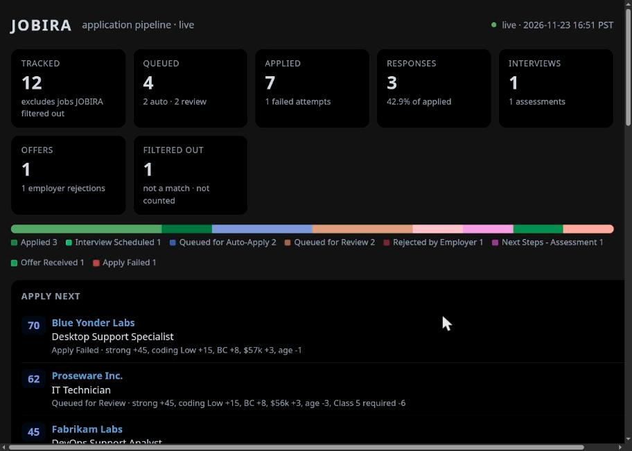

# JOBIRA

A local, stdlib-first job-search pipeline: it scores postings against a fact file, generates a tailored resume and cover letter per job, logs everything to one CSV tracker, and serves a live dashboard (desktop and phone).



*Screenshot uses fictional demo data (`demo/application_tracker.csv`).*

## What it does

- **Tracker:** one CSV (`track_sheet/application_tracker.csv`) is the source of truth. Every view (xlsx, dashboards, ranking) is regenerated from it.
- **Matching:** `ats_scorer.py` and `ats_v2.py` score a resume against the posting text. `tech_mapper.py` lists equivalent tools already in a resume.
- **Generation:** `generate_and_log.py` builds a resume PDF and a cover-letter DOCX via `md2pdf.py` (LibreOffice headless) and logs the row.
- **Dashboards:** `local_dashboard_server.py` (desktop, port 8420) and `mobile_dashboard.py` (phone and tablet, passcode-protected). `build_dashboard.py` writes a static snapshot.
- **Ranking and status:** `rank.py` orders queued jobs; `status.py` shows the unattended loop and tracker counts.
- **Unattended loop:** `auto_run.sh` repeatedly runs a headless agent that scrapes, filters, and queues jobs. It does not submit applications.

## Setup

```bash
```

You supply your own data. Nothing in this repo is personal:

1. Write your fact file as `skill_file` in the project root. The generators read facts only from it.
2. Put your own resumes and cover letters in `resumes/` and `cover_letters/` (both are created on first run).
3. Point the tracker at a file with `JOBIRA_TRACKER_CSV`, or use the default `track_sheet/application_tracker.csv`.

Try the dashboard on the demo data without any personal files:

```bash
JOBIRA_TRACKER_CSV=demo/application_tracker.csv python3 local_dashboard_server.py 8420
# open http://127.0.0.1:8420/
```

## Notes

- The dashboards listen on `127.0.0.1` only. Remote access is documented in `mobile/README.md`; it uses your own private network, not a public host.
- The mobile app's Android build (signing keys, host settings) is not included. See `mobile/README.md`.
- The agent prompts and the job-application rules are project-specific, and this repo does not include them.
Unattended-loop note: auto_run.sh calls the `claude` CLI, which must be installed separately.
